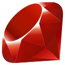

# Amesio

For full usage and API reference, see the [documentation](https://amesio.com/documentation/api).

---

## SDKs

| | | | | |
|:---:|:---:|:---:|:---:|:---:|
|  C# coming soon |  CLI coming soon |  cURL coming soon |  Dart coming soon |  Elixir coming soon |
|  Go coming soon |  Haskell coming soon |  Java coming soon |  JavaScript coming soon |  Kotlin coming soon |
|  Lua coming soon |  PHP coming soon |  Python coming soon |  R coming soon |  Ruby coming soon |
|  Rust coming soon |  Scala coming soon |  Swift coming soon |  TypeScript coming soon |  |

---

## Integrations

| | | | | |
|:---:|:---:|:---:|:---:|:---:|
|  API Mock coming soon |  OpenAPI coming soon |  Pinia coming soon |  Postman coming soon |  Redux coming soon |

---

## Products

| | | | | |
|:---:|:---:|:---:|:---:|:---:|
|  Connect coming soon |  |  |  |  |
